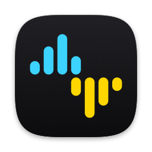

<p align="center">
  
</p>

<h1 align="center">Moting</h1>

<p align="center">面向 macOS 的本地会议录音、语音转写与 AI 纪要工具。</p>

<p align="center">
  <a href="#快速开始">快速开始</a> ·
  <a href="#数据与隐私">数据与隐私</a> ·
  <a href="CONTRIBUTING.md">参与开发</a> ·
  <a href="docs/README.md">项目文档</a>
</p>

Moting 是一款 macOS 会议录音与转写应用：分别录制麦克风和系统音频，在本机完成语音识别、说话人区分，并通过可配置的 AI 服务生成会议纪要。

**项目状态：开发中。** 当前应用版本为 `0.1.0`，尚不承诺稳定的接口和数据格式。界面支持简体中文和英文。

## 功能

- 双路录音、暂停与继续、菜单栏控制，以及全局快捷键 `⌥⌘R`。
- 实时字幕、会后离线转写、说话人区分与个人声纹匹配。
- 会议回放、转写稿编辑、文本复制与 Markdown 导出。
- 可配置 OpenAI 兼容接口或本机 Ollama，生成会议纪要。
- 本机模型下载与管理、存储用量查看，以及日历标题匹配。

## 环境要求

- Apple Silicon Mac（当前 sherpa-onnx 下载脚本仅提供 arm64 静态库）。
- macOS 14.2 或更高版本。
- Xcode 16 或更高版本，包含 Swift 6 工具链。
- XcodeGen；如使用 Homebrew，可执行 `brew install xcodegen`。
- 首次准备依赖和下载识别模型需要联网。

## 快速开始

### 下载安装

从 [GitHub Releases](https://github.com/lidedongsn/moting/releases/latest) 下载 `Moting-0.1.0-macOS-arm64.zip`，解压后将 `Moting.app` 拖入“应用程序”。支持 Apple Silicon 和 macOS 14.2 及以上版本。

当前下载包采用临时签名，未经 Apple 公证。首次打开的限制、安装步骤与校验方法见 [发布说明](docs/releases/v0.1.0.md)。

### 准备依赖与工程

在仓库根目录执行：

```sh
# 下载固定版本的 sherpa-onnx，生成本机二进制依赖
./Scripts/fetch-sherpa-onnx.sh

# 创建本机签名配置；在其中填写自己的 DEVELOPMENT_TEAM
cp App/Local.xcconfig.example App/Local.xcconfig

# 生成 Xcode 工程
(cd App && xcodegen generate)
open App/Moting.xcodeproj
```

在 Xcode 中选择 `Moting` scheme，确认 Signing & Capabilities 中使用自己的开发团队，然后运行。`Local.xcconfig` 和生成的 `.xcodeproj` 已被忽略；工程配置以 [App/project.yml](App/project.yml) 为准。

### 编译验证

以下命令从仓库根目录执行，仅编译，不进行签名或安装：

```sh
xcodebuild -project App/Moting.xcodeproj -scheme Moting \
  -configuration Debug -derivedDataPath .build/xcode \
  CODE_SIGNING_ALLOWED=NO build
```

### 首次使用

1. 启动应用，按引导授予麦克风和系统音频录制权限。
2. 下载所需语音模型；日历和通知权限可按需授予。
3. 从主窗口、菜单栏或通过 `⌥⌘R` 开始和结束录音。
4. 在会议详情中查看转写、编辑说话人，并按需配置 AI 纪要服务。

模型下载完成后，录音与语音识别可以在本机进行。

### 安装到本机

如需安装 Release 版，可在配置好签名后，从仓库根目录运行 `./Scripts/install-app.sh`。该脚本会替换 `/Applications/Moting.app` 并打开应用；检测到正在录音时会停止安装。

## 数据与隐私

- Release 版的数据保存在 `~/Library/Application Support/Moting/`，包括数据库、会议音频、识别模型和个人声纹。
- Debug 版默认使用 `~/Library/Application Support/Moting Debug/`，与正式版数据分开。
- 语音识别在本机执行。调用远程 AI 纪要服务时，转写文本及提示词会发送到所选服务；使用本机 Ollama 时，请求发送到配置的本机接口。
- AI 服务的 API Key 保存在 macOS 钥匙串中，不写入仓库配置。
- 请勿将真实会议、声纹、模型、密钥或签名材料提交到 Git。忽略规则不能移除已经进入 Git 历史的文件。

## 开发与测试

```sh
# 先完成上述二进制依赖准备，再运行默认测试
swift test

# 可选：启用仓库自带的提交前检查
git config core.hooksPath Scripts/git-hooks
```

默认测试不启用需要真实录音、联网下载或本机会议数据的集成测试。环境变量和更多开发说明见 [CONTRIBUTING.md](CONTRIBUTING.md)。

仓库包含 [GitHub Actions 工作流](.github/workflows/ci.yml)，在推送和 Pull Request 时执行 Swift 测试及应用编译检查。CI 不执行安装、签名或发布。

## 问题反馈

请通过 GitHub Issues 报告问题或提出功能建议。问题报告应包含 macOS 版本、芯片架构、应用版本、复现步骤，以及预期和实际结果。请使用合成数据复现，避免上传真实会议、声纹或 API Key。

## 目录

| 路径 | 内容 |
| --- | --- |
| `App/` | SwiftUI 应用、资源、翻译和 XcodeGen 配置 |
| `Sources/` | 录音、存储、识别、回放、音频处理与纪要模块 |
| `Tests/` | 单元测试及按需启用的集成测试 |
| `Scripts/` | 依赖准备、安装、翻译检查和 Git hook |
| `docs/` | 文档索引、设计记录、实施计划与待办 |
| `Vendor/` | 本机生成的二进制依赖，不提交到 Git |

## 许可证与第三方代码

本项目的原创代码采用 [MIT License](LICENSE)。第三方代码、依赖和识别模型遵循各自的许可；详细信息见 [THIRD_PARTY_NOTICES.md](THIRD_PARTY_NOTICES.md)。
